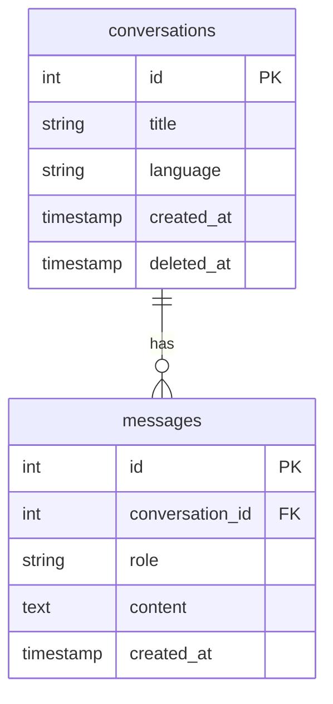

# Database ERD

## Design notes

- **Soft delete scope:** Soft delete is applied at the `conversations` level only. A message's deleted state is derived from its parent conversation (a message is considered deleted when its conversation's `deleted_at` is set).
- **No `deleted_at` on `messages` (by design / YAGNI):** Add it via a migration only when per-message deletion is introduced.
- **`ON DELETE CASCADE` purpose:** The FK cascade on `messages.conversation_id` exists for the hard-delete (purge) path only. It fires when a conversation row is physically deleted by the purge job — not during soft delete, which is an `UPDATE` and does not trigger cascades.
- **"Soft cascade":** Propagating `deleted_at` to child messages is application-layer logic (service layer), to be implemented only if/when per-message soft delete is added.
